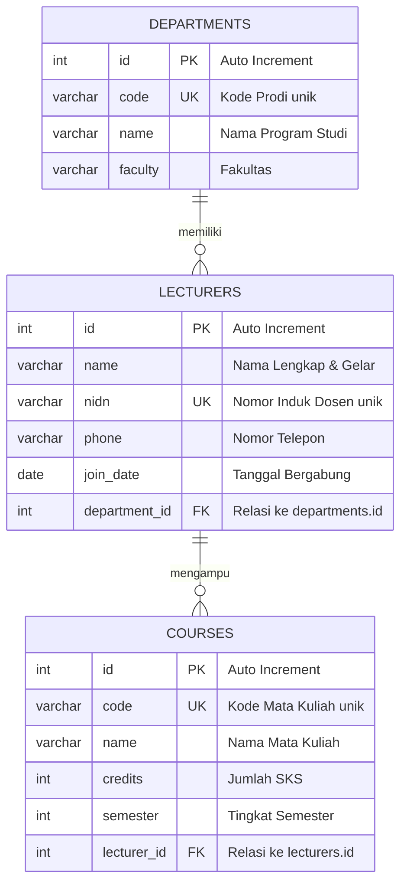
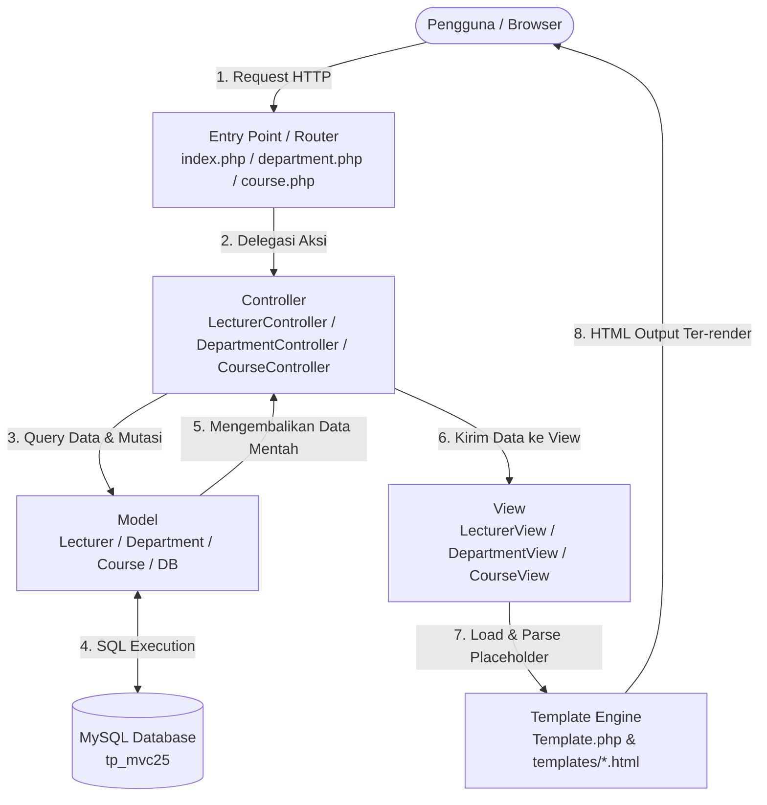
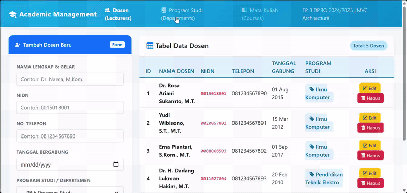

# TP8DPBO2425C1 - TUGAS PRAKTIKUM 8 DPBO (MODEL-VIEW-CONTROLLER / MVC)

## JANJI
> Saya **Najib Nurohman** dengan NIM **2509653** mengerjakan **Tugas Praktikum 8** dalam mata kuliah **Desain Pemrograman Berorientasi Objek (DPBO)** untuk keberkahan-Nya maka saya tidak akan melakukan kecurangan seperti yang telah dispesifikasikan. Aamiin.

---

## DESKRIPSI SISTEM
Aplikasi ini merupakan sistem informasi manajemen akademik kampus berbasis web yang mengelola data **Dosen (Lecturers)**, **Program Studi / Departemen (Departments)**, dan **Mata Kuliah (Courses)**. 

Proyek ini merupakan hasil refaktor dan pengembangan dari kode prosedural/monolitik awal menjadi arsitektur **Model-View-Controller (MVC)** berorientasi objek murni menggunakan bahasa **PHP Native**, **MySQL Database**, dan styling antarmuka modern menggunakan **Bootstrap 5**.

### Pemenuhan Spesifikasi Tugas Praktikum:
1. **Refaktor ke Arsitektur MVC**:
   - Memisahkan kode secara ketat menjadi 3 komponen logika utama: **Model** (data & query), **View** (rendering antarmuka pengguna & template engine), dan **Controller** (penghubung logika bisnis & penanganan request).
   - Penggunaan engine parsing template (`Template.php`) untuk memisahkan logika PHP dari kode markup HTML secara bersih.
2. **Penambahan 2 Tabel Baru Berelasi**:
   - **Tabel `departments`**: Master data program studi/departemen yang berelasi *One-to-Many* dengan tabel `lecturers` (`lecturers.department_id -> departments.id`).
   - **Tabel `courses`**: Master data mata kuliah yang berelasi *Many-to-One* dengan tabel `lecturers` (`courses.lecturer_id -> lecturers.id`).
3. **Penerapan Operasi CRUD Penuh**:
   - Fitur **Create, Read, Update, Delete (CRUD)** diimplementasikan secara menyeluruh untuk ketiga entitas (`lecturers`, `departments`, `courses`).
4. **Modifikasi Atribut Entitas Awal**:
   - Tabel `lecturers` diperkaya dengan atribut foreign key `department_id` yang terhubung secara relasional dengan tabel `departments` (ON DELETE SET NULL ON UPDATE CASCADE).
5. **Struktur Repository Rapi**:
   - Memenuhi struktur folder yang dipersyaratkan: `Project/`, `Dokumentasi/`, file SQL (`tp_mvc25.sql`), dan dokumentasi lengkap di `README.md`.

---

## STRUKTUR BASIS DATA & RELASI (ERD)

Sistem menggunakan database bernama `tp_mvc25` yang terdiri atas 3 tabel berelasi:
1. **`departments`**: Menyimpan kode prodi, nama prodi, dan fakultas.
2. **`lecturers`**: Menyimpan identitas dosen (nama, NIDN, nomor telepon, tanggal bergabung, dan foreign key ID prodi).
3. **`courses`**: Menyimpan informasi mata kuliah (kode matkul, nama matkul, SKS, semester, dan foreign key ID dosen pengampu).

### Entity Relationship Diagram (ERD)



---

## DESAIN ARSITEKTUR MODEL-VIEW-CONTROLLER (MVC)

Aplikasi menerapkan pola arsitektur MVC yang modular dan terstruktur:



### Rincian Komponen:
1. **Model (`Project/models/`)**:
   - `DB.php`: Kelas pembungkus koneksi basis data menggunakan ekstensi MySQLi (`open()`, `execute()`, `getResult()`, `close()`).
   - `Lecturer.php`: Mewarisi kelas `DB`, menyediakan query untuk menampilkan dosen dengan informasi prodi (JOIN), menambah dosen, memperbarui data dosen, serta menghapus data dosen.
   - `Department.php`: Mewarisi kelas `DB`, menyediakan query agregasi jumlah dosen tiap prodi, serta operasi CRUD prodi.
   - `Course.php`: Mewarisi kelas `DB`, menyediakan query relasional mata kuliah bersama dosen pengampu dan prodi, serta operasi CRUD mata kuliah.
2. **View (`Project/views/` & `Project/templates/`)**:
   - `Template.php`: Engine templating yang memuat file HTML mentah dan melakukan penggantian pola placeholder string (`DATA_...`) dengan data dinamis hasil proses model.
   - `LecturerView.php`, `DepartmentView.php`, `CourseView.php`: Mengorganisir pembentukan elemen HTML (tabel, badge, opsi dropdown, form input) lalu memanggil template untuk dicetak ke browser.
   - `templates/lecturer.html`, `templates/department.html`, `templates/course.html`: File presentasi antarmuka berbasis Bootstrap 5 dengan desain responsif split layout (form di kiri, tabel data di kanan).
3. **Controller (`Project/controllers/`)**:
   - Mengendalikan alur logika dan respon: memvalidasi parameter request (GET / POST), memanggil method pada model terkait, dan mengarahkan data ke view untuk dirender atau melakukan redirect URL setelah operasi mutasi (Create, Update, Delete) berhasil.
4. **Entry Point**:
   - `index.php`: Mengelola alur antarmuka data Dosen.
   - `department.php`: Mengelola alur antarmuka data Program Studi / Departemen.
   - `course.php`: Mengelola alur antarmuka data Mata Kuliah.

---

## STRUKTUR REPOSITORI

```
TP 8/
├── Dokumentasi/                    # Folder bukti pengujian & dokumentasi
│   └── README.md
├── Project/                        # Folder utama aplikasi berarsitektur MVC
│   ├── controllers/
│   │   ├── CourseController.php
│   │   ├── DepartmentController.php
│   │   └── LecturerController.php
│   ├── models/
│   │   ├── Course.php
│   │   ├── DB.php
│   │   ├── Department.php
│   │   └── Lecturer.php
│   ├── templates/
│   │   ├── course.html
│   │   ├── department.html
│   │   └── lecturer.html
│   ├── views/
│   │   ├── CourseView.php
│   │   ├── DepartmentView.php
│   │   ├── LecturerView.php
│   │   └── Template.php
│   ├── bootstrap.bundle.min.js
│   ├── bootstrap.min.css
│   ├── bootstrap.min.js
│   ├── jquery.min.js
│   ├── popper.min.js
│   ├── config.php                  # Konfigurasi database MySQL
│   ├── course.php                  # Entry point halaman Mata Kuliah
│   ├── department.php              # Entry point halaman Program Studi
│   ├── index.php                   # Entry point utama (halaman Dosen)
│   └── tp_mvc25.sql                # Salinan file database di dalam project
├── tp_mvc25.sql                    # File database utama untuk diimport
└── README.md                       # Dokumentasi resmi tugas praktikum
```

---

## PANDUAN MENJALANKAN APLIKASI

### Langkah 1: Persiapan Web Server & Database
1. Buka aplikasi **XAMPP Control Panel**.
2. Nyalakan modul **Apache** dan **MySQL** hingga berstatus hijau (*Running*).

### Langkah 2: Import Database
1. Buka browser dan akses [http://localhost/phpmyadmin](http://localhost/phpmyadmin).
2. Buat database baru bernama `tp_mvc25` (atau langsung gunakan menu **Import**).
3. Klik tab **Import** pada phpMyAdmin, lalu pilih file `tp_mvc25.sql` yang berada di folder proyek ini.
4. Klik tombol **Go / Kirim** untuk mengeksekusi import seluruh tabel (`departments`, `lecturers`, `courses`) beserta data dummy awalnya.

### Langkah 3: Penempatan Direktori Project
1. Salin folder `Project` ke direktori root web server lokal Anda, misalnya ke:
   ```

   C:\xampp\htdocs\TP8\
   ```
   *(Atau buat virtual host / symlink ke folder `Project`)*.
2. Pastikan file `config.php` telah sesuai dengan setelan database lokal Anda:
   - Hostname: `localhost`
   - Username: `root`
   - Password: `""` (kosong secara default di XAMPP)
   - Database: `tp_mvc25`

### Langkah 4: Menjalankan Aplikasi di Browser
Buka browser dan akses alamat berikut:
- **Halaman Manajemen Dosen**: [http://localhost/TP8/index.php](http://localhost/TP8/index.php)
- **Halaman Manajemen Program Studi**: [http://localhost/TP8/department.php](http://localhost/TP8/department.php)
- **Halaman Manajemen Mata Kuliah**: [http://localhost/TP8/course.php](http://localhost/TP8/course.php)

---

## FITUR & DOKUMENTASI PENGUJIAN

### 1. Modul Dosen (Lecturers)
- **Create**: Menambahkan data dosen baru lengkap dengan nama, NIDN, nomor telepon, tanggal bergabung, dan pemilihan program studi asal.
- **Read**: Menampilkan daftar dosen dalam bentuk tabel dengan penanda badge prodi.
- **Update**: Memuat form edit untuk memperbarui data profil dosen dan program studinya.
- **Delete**: Menghapus data dosen dengan konfirmasi keamanan popup.

### 2. Modul Program Studi (Departments)
- **Create**: Menambahkan data program studi baru (Kode, Nama Prodi, dan Fakultas).
- **Read**: Menampilkan daftar program studi beserta statistik jumlah dosen yang terdaftar di prodi tersebut.
- **Update**: Memperbarui informasi kode, nama, atau fakultas program studi.
- **Delete**: Menghapus program studi dengan proteksi integritas basis data (`ON DELETE SET NULL`).

### 3. Modul Mata Kuliah (Courses)
- **Create**: Menambahkan mata kuliah baru dengan penentuan kode, nama matkul, bobot SKS, semester, dan dosen pengampu mata kuliah.
- **Read**: Menampilkan daftar mata kuliah lengkap dengan detail SKS, semester, dan nama dosen pengampu.
- **Update**: Memperbarui informasi detail mata kuliah dan dosen pengampunya.
- **Delete**: Menghapus mata kuliah dari kurikulum.

---

## DOKUMENTASI HASIL PROYEK & PENGUJIAN

Berikut adalah rekaman demonstrasi menyeluruh pengujian fitur CRUD dan relasi data antar entitas pada sistem:

### Animasi Demonstrasi Sistem (GIF)



> 📹 **Video Demo Lengkap**: File video rekaman demonstrasi dalam format MP4 juga tersedia di folder [`Dokumentasi/TP8_Demo.mp4`](Dokumentasi/TP8_Demo.mp4).

---

### Rincian Skenario Demonstrasi yang Diuji:

| No | Modul / Fitur | Aksi Pengujian | Hasil yang Diharapkan | Status |
|:--:|:---|:---|:---|:--:|
| 1 | **Manajemen Dosen** | Menambahkan data dosen baru dengan memilih Program Studi asal | Data berhasil tersimpan ke database `tp_mvc25` dan langsung tampil pada tabel dosen dengan badge prodi | ✅ Berhasil |
| 2 | **Manajemen Dosen** | Mengklik tombol *Edit*, form otomatis terisi data lama, lalu mengubah nomor telepon / data dosen | Data dosen terupdate secara real-time di tabel setelah tombol simpan ditekan | ✅ Berhasil |
| 3 | **Manajemen Dosen** | Menekan tombol *Hapus* pada baris dosen | Muncul pop-up konfirmasi JavaScript, setelah disetujui baris dosen terhapus dari tabel dan basis data | ✅ Berhasil |
| 4 | **Program Studi** | Menambahkan data program studi baru (Kode, Nama, Fakultas) | Data prodi baru muncul di tabel prodi dengan counter jumlah dosen | ✅ Berhasil |
| 5 | **Program Studi** | Melakukan update dan pengeditan informasi fakultas / nama departemen | Perubahan langsung tercermin di tabel prodi | ✅ Berhasil |
| 6 | **Program Studi** | Menguji penghapusan prodi yang berelasi dengan dosen | Data dosen terkait tetap aman dan status prodinya berubah menjadi *Belum Ditentukan* (`SET NULL`) | ✅ Berhasil |
| 7 | **Mata Kuliah** | Menambahkan mata kuliah baru dengan menentukan SKS, Semester, dan Dosen Pengampu | Mata kuliah tampil pada tabel lengkap beserta identitas dosen pengampu hasil relasi `JOIN` | ✅ Berhasil |
| 8 | **Mata Kuliah** | Mengedit SKS, semester, dan mengganti dosen pengampu | Perubahan data mata kuliah tersimpan dan langsung ditampilkan | ✅ Berhasil |
| 9 | **Mata Kuliah** | Menghapus mata kuliah dari daftar | Baris mata kuliah berhasil dihapus dari sistem | ✅ Berhasil |
